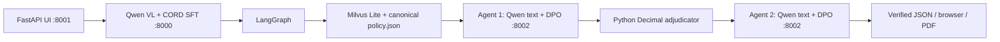

# Claim Adjudication Copilot

Hospital invoice image assessment with local vision extraction, two policy
reasoning agents, canonical Milvus policy retrieval and authoritative Python
`Decimal` calculations. FastAPI provides an image-only browser UI and a
downloadable, itemized PDF report. No paid API or OpenAI key is required.

The owner reports a successful final image-to-PDF demo using CORD SFT extraction
and DPO reasoning. This cleanup does not independently rerun that verification.



Agents select scoped policy/fact references; Python validates them against real
evidence. Agents cannot set reimbursement amounts. Unknown clinical conditions
remain pending review, and null final reimbursement displays **Not finalized**.
The browser separately extracts invoice-date metadata from the image and rejects
missing/ambiguous dates; it never substitutes a date to make a policy valid.

## Models, training and data

| Responsibility | Backbone | Adapter |
| --- | --- | --- |
| Final invoice extraction | `Qwen/Qwen2.5-VL-3B-Instruct` | CORD SFT |
| Original extraction / rollback | Same vision-language backbone | Original synthetic SFT |
| Both reasoning agents | `Qwen/Qwen2.5-3B-Instruct` | DPO |

All adapters use rank-8 language-attention LoRA; training used QLoRA. Vision
extraction and text reasoning remain separate. DPO compares preferred/rejected
responses against the frozen base policy; no PPO or reward model is used.
Successful pointers and artifact details: [models/README.md](models/README.md).

- Synthetic hospital SFT: 10 invoices, 8 train / 2 validation.
- Real CORD: 200 strictly eligible receipts, 161 train / 20 validation / 19 test;
  explicit item, quantity, rate and amount with checked Decimal arithmetic.
- DPO: 80 synthetic policy-grounded pairs, 60 train / 10 validation / 10 test,
  using actual Agent 1 and Agent 2 JSON contracts.
- Original Optum evaluation: five supplied invoices with manually transcribed
  labels; excluded from training. Original image publication needs clearance.
- `data/policy.json` is the authoritative policy; the local Milvus database is
  built separately and is not committed.

User-reported evaluation: **CORD row F1 53.33% → 84.21% on 19 held-out receipts**;
CSV validity 63.16% → 89.47%. **The adapters tied on extraction accuracy on the
five Optum invoices.** CORD SFT is the owner's verified final-demo configuration,
not evidence of a healthcare-accuracy advantage. DPO increased preference margins
but did not improve unconstrained generated-answer accuracy (6/10 for both text
models in the observed small test). Preference accuracy is not claim accuracy.
See [evaluation/](evaluation/) for reproducible existing tools and limitations.

## Repository

```text
app/          FastAPI, browser assets, invoice-date metadata, PDF reports
trainer/      Index of existing training tools (no duplicated Python modules)
evaluation/   Index of existing evaluation tools
src/          agents, orchestration, rag, adjudication, inference, trainer, config
models/       Three successful adapter pointers, selected runs and LFS weights
notebooks/    Retained historical Colab notebook
docs/         Operations, cleanup/delivery report, historical implementation notes
tests/        Existing CPU regression suites
deploy/       Existing vision launcher and permanent reasoning launcher
scripts/      Existing CLI, policy-index and integration tools
data/         Policy, synthetic/preference fixtures and evaluation labels
reports/      Local generated results; historical documentation retained
requirements*.txt
README.md
```

Working module/import paths are unchanged. Old compatibility wrappers remain.

## Environment and installation

Run from `/home/rishabh_mishra0440/optum_claim_adjudication/optum_claim_adjudication`.
Reuse **Python 3.12 `../.venv`** for app/training and **`~/.venv-vllm`** for serving.
Ubuntu 24.04, one NVIDIA L4 (24 GB). Never bulk-install training constraints into
the serving environment or replace working Torch/CUDA packages.

```bash
source ../.venv/bin/activate
python -m pip check
python -m pip show fastapi uvicorn pydantic Pillow httpx python-multipart reportlab langgraph pymilvus sentence-transformers
cat requirements.txt requirements-workflow.txt requirements-rag.txt requirements-web.txt
```

The requirements files are preserved. Only if a runtime dependency is missing,
preview the applicable requirements with `python -m pip install --dry-run -r
requirements-web.txt` (or the corresponding file), then install the missing
package after checking that the plan preserves the working stack. Training pins
remain in `requirements-sft*.txt` / `requirements-dpo.txt`; serving constraints
remain in `deploy/vllm/constraints.txt`. No package changes are made by cleanup.
Existing cached backbones and embedding model are required. A fresh clone needs
LFS weights and manual policy-index setup; see [operations](docs/OPERATIONS.md).

## Exact three-terminal demo startup

Run each terminal from the repository root. Reuse an already running server
instead of starting another on the same port. Do not train while serving.

**Terminal 1 — CORD image extractor, port 8000:**

```bash
OPTUM_SFT_OUTPUT_DIR=models/qwen25_vl_cord_sft VLM_PYTHON="$HOME/.venv-vllm/bin/python" bash deploy/vllm/start_vlm.sh adapter --gpu-memory-utilization 0.40
```

**Terminal 2 — text DPO reasoning, port 8002:**

```bash
REASONING_PYTHON="$HOME/.venv-vllm/bin/python" bash deploy/vllm/start_reasoning.sh
```

The permanent script preserves the working temporary launcher's model,
tokenizer, served names, BF16, 2048-token context, one sequence, rank 8 and 0.40
memory allocation. It resolves the successful adapter with the existing checksum
helper rather than a hardcoded VM run path. No base-model fallback is provided.

**Terminal 3 — application, port 8001:**

```bash
source ../.venv/bin/activate
OPTUM_REASONING_BACKEND=text_dpo VLM_BASE_URL=http://127.0.0.1:8000/v1 python -m uvicorn app.main:app --host 127.0.0.1 --port 8001 --workers 1
```

Privately forward **8001** in VS Code and open **http://127.0.0.1:8001**. Upload
`data/demos/claim_2024/invoice_2024.jpg`; this is a clearly marked synthetic demo,
separate from training. Inspect the extracted date, real policy citations, item
amounts and review concerns, then use **Download PDF Report**. Reports are saved
under `reports/claims/<request_id>/`; null reimbursement must read NOT FINALIZED.

## Verification and limitations

Exact imports, CPU tests, hashes, health checks, image CLI, PDF download and
rollback commands: [docs/OPERATIONS.md](docs/OPERATIONS.md).
Git LFS setup, publication blockers and reviewed commit/push commands:
[docs/CLEANUP_REPORT.md](docs/CLEANUP_REPORT.md).

This is a local prototype with no multi-user authentication: all ports remain
loopback-only. Use one application worker and bounded in-process jobs; jobs do
not survive restarts. Private reports persist locally until manually removed.
Model-derived dates/extractions require inspection; small synthetic and retail
tests do not establish clinical generalization. Medicines without confirmed
medical relationship remain REVIEW_REQUIRED, even after a valid Agent 2 review.
Both model servers sharing the L4 require GPU monitoring; do not run comparison
evaluation or training alongside them. No runtime logic, datasets or model
weights were changed, and no tests or services were run during cleanup.

Earlier phase notes are preserved in
[docs/IMPLEMENTATION_HISTORY.md](docs/IMPLEMENTATION_HISTORY.md); their older
ports, startup instructions and status claims are not the final configuration.
