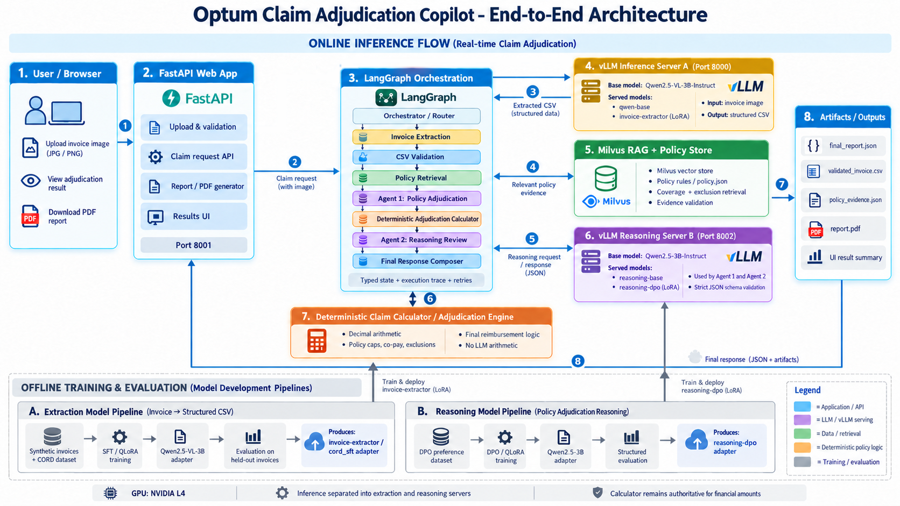

# Claim Adjudication

A hospital invoice image becomes an itemized claim assessment with policy citations, reimbursement calculations, review concerns, and a downloadable PDF. The application combines a trained invoice extractor, policy retrieval, two reasoning agents, and deterministic financial calculations behind an image-only FastAPI interface.

## 1. System architecture

LangGraph coordinates invoice extraction, CSV validation, policy retrieval, policy adjudication, deterministic calculation, reasoning review, and final response assembly. Extraction and reasoning run on separate vLLM servers; both reasoning agents use the same DPO adapter. Python `Decimal` calculations apply policy caps, exclusions, and co-pay. Missing clinical evidence leaves affected amounts pending review.



| Component | Responsibility | Implementation |
| --- | --- | --- |
| FastAPI application · port **8001** | Accept an invoice image, extract its printed date, display results, and generate a PDF | `UI/`; entry point `src.main:app` |
| LangGraph orchestration | Manage request state, conditional routing, bounded retries, and execution traces | `src/components/agentic_workflow/` |
| Vision vLLM server · port **8000** | Use `invoice-extractor` for image-to-CSV extraction and `qwen-base` for invoice-date metadata | Qwen2.5-VL-3B with the CORD SFT adapter |
| Milvus Lite policy retrieval | Retrieve coverage/exclusion evidence and resolve it against the authoritative policy | `src/components/rag/`; `data/assignment_dataset/policy.json` |
| Reasoning vLLM server · port **8002** | Serve `reasoning-dpo` for Agent 1 policy selection and Agent 2 evidence review | Qwen2.5-3B with the DPO adapter |
| Deterministic calculator | Calculate eligible, disallowed, pending, co-pay, and reimbursement amounts | `src/utils/calculator.py` |

The policy index contains **45 rules: 25 coverage and 20 exclusion rules**. Retrieval uses `all-MiniLM-L6-v2` CPU embeddings with **384 dimensions**. Agents return structured selections; the application validates references and retains the calculator as the authority for financial amounts.

## 2. Model training

Two separate adapters support the application: **SFT with QLoRA for invoice extraction**, and **DPO with QLoRA for policy reasoning**.

| Training approach | Base model / backbone | Dataset used | Key configuration values | Recorded training and validation metrics |
| --- | --- | --- | --- | --- |
| **SFT + QLoRA — invoice extraction** | `Qwen/Qwen2.5-VL-3B-Instruct` | **200 CORD receipts**: 161 train / 20 validation / 19 held-out test; `data/cord_sft_qlora/` | 4-bit NF4 + double quantization; BF16 compute; language-attention LoRA on `q_proj`, `k_proj`, `v_proj`, `o_proj`; rank **8**, alpha **16**, dropout **0.05**; **2 epochs / 82 optimizer steps**; learning rate **1e-4**; batch **1**, accumulation **4**; sequence length **2048**; image pixels **50,176–200,704** | Mean training loss **0.08520**; validation loss **0.09380**; teacher-forced validation token accuracy **98.13%**; **3,686,400** trainable parameters; training duration **315.98 s**; peak allocated GPU memory **3.50 GiB** |
| **DPO + QLoRA — policy adjudication and reasoning review** | `Qwen/Qwen2.5-3B-Instruct` | **80 synthetic policy-grounded preference pairs**: 60 train / 10 validation / 10 held-out test; both agent contracts; `data/policy_reasoning_dpo_qlora/` | 4-bit NF4 + double quantization; BF16 compute; attention LoRA on `q_proj`, `k_proj`, `v_proj`, `o_proj`; rank **8**, alpha **16**; effective dropout **0**; DPO beta **0.1**; **20 optimizer steps**; learning rate **1e-5**; batch **1**, accumulation **4**; sequence length **2048**; frozen base reference with LoRA disabled | Mean training loss **0.62563**; validation DPO loss **0.53911**; validation reward accuracy **100%**; validation reward margin **0.34146**; training runtime **113.35 s**; total run duration **130.36 s**; peak allocated GPU memory **3.09 GiB** |

Both runs used an **NVIDIA L4**, `paged_adamw_8bit`, and seed **42**. The SFT vision tower and base weights remain frozen. DPO selects the checkpoint with the lowest validation loss; its configured dropout is 0.05, with the effective training dropout disabled by the trainer.

Training measurements come from the selected runs' saved [SFT metrics](models/qwen25_finetune_sf_qlora/runs/20261011T134348Z-f1e33111/metrics.json) and [DPO metrics](models/qwen_25_finetune_dpo_qlora/runs/20261011T074847Z-60ab777d/metrics.json). Their configurations are saved alongside them. Teacher-forced token accuracy and DPO reward accuracy measure training behavior; generated-output performance is reported separately below.

## 3. Evaluation

### Invoice extraction output metrics

These measurements are for the **retained CORD SFT adapter**. The CORD test contains **19 receipts and 38 reference rows**. Assignment evaluation contains **5 original invoices and 26 manually transcribed reference rows**, excluded from training.

| Output metric | CORD held-out test · 19 receipts | Assignment invoices · 5 images |
| --- | --- | --- |
| Valid CSV / eligible completion | **89.47% · 17/19** | **100% · 5/5** |
| Exact document match | **42.11% · 8/19** | **80% · 4/5** |
| Order-insensitive exact document match | **42.11% · 8/19** | **80% · 4/5** |
| Row-alignment precision | **84.21% · 32/38** | **100% · 26/26** |
| Row-alignment recall | **84.21% · 32/38** | **100% · 26/26** |
| Row-alignment F1 | **84.21%** | **100%** |
| Complete-row exact recall / precision | **47.37% · 18/38** | **76.92% · 20/26** |
| Item field accuracy | **50% · 19/38** | **100% · 26/26** |
| Quantity field accuracy | **84.21% · 32/38** | **100% · 26/26** |
| Rate field accuracy | **81.58% · 31/38** | **76.92% · 20/26** |
| Amount field accuracy | **81.58% · 31/38** | **96.15% · 25/26** |
| Missing / extra rows | **6 / 6** | **0 / 0** |
| Parse failures / invalid numeric fields / arithmetic errors | **1 / 2 / 1** | **0 / 0 / 0** |
| Rate mismatches / amount mismatches | **7 / 7** | **6 / 1** |
| Truncations / inference errors | **0 / 0** | **0 / 0** |
| Average extraction latency | **8.35 s/image** | **14.24 s/image** |
| Total extraction latency / generated tokens | **158.62 s / 1,311** | **71.21 s / 588** |

Row-alignment F1 measures matched rows; it does not require every field in a matched row to be correct. Complete-row exact match requires all four fields to match. Names use whitespace normalization, numbers use `Decimal` equality, and reference labels preserve absent printed rates as empty. These small test sets measure extraction performance rather than end-to-end claim accuracy.

### Evaluation at each stage

| Flow stage | Metric / check | Measured result | Evaluation scope |
| --- | --- | --- | --- |
| Upload and invoice-date metadata | Valid JPG/PNG, readable unambiguous printed invoice date | Saved application example: date **FOUND**; missing/ambiguous dates require review | Runtime validation; no aggregate date-accuracy benchmark recorded |
| Invoice extraction and CSV validation | Header, four fields, numeric validity, quantity × printed rate = amount | **17/19** valid CORD CSV outputs; **5/5** valid assignment outputs | Retained SFT extraction evaluations above |
| Policy retrieval | Recall@1 / Recall@3 | **95% · 19/20** / **100% · 20/20** | 20 curated policy queries through the actual local Milvus index |
| Policy rule resolution | Correct resolved rule / grounded rule and conditions | **100% · 20/20** / **100% · 20/20** | Same curated queries; grounded against the canonical policy |
| Agent 1 — policy adjudication | Valid schema / semantically correct response | **100% · 5/5** / **100% · 5/5** | DPO free-generation held-out test, Agent 1 subset |
| Agent 1 — policy selections | Classification / candidate / basis correctness; coverage / exclusion selection | **100% · 10/10** for each of the first three; **8/8** coverage and **2/2** exclusion selections | Row-level decisions within the same five Agent 1 prompts |
| Deterministic calculator | Rule ID / line status / eligible amount match | **100% · 26/26** for each metric | Five reference invoices supplied as correct structured data; isolates policy/calculator behavior |
| Deterministic calculator | Exact invoice totals, including eligible total, co-pay and reimbursement | **100% · 5/5** | Same structured-reference evaluation; excludes image extraction |
| Agent 2 — unconstrained reasoning review | Valid schema / semantically correct response | **20% · 1/5** / **20% · 1/5** | DPO free-generation held-out test, Agent 2 subset |
| Agent 2 — schema-constrained reasoning review | Valid JSON / schema / scoped references / semantic correctness | **100% · 5/5** for each | Separate vLLM diagnostic on five **validation** prompts with strict JSON schema |
| Agent 2 — schema-constrained fact review | Correct facts / concerns / status; wrong-item evidence | **100% · 10/10** for each; **0/5** wrong-item evidence cases | Same validation diagnostic; average generation time **2.87 s** |
| Final response assembly | Reconciled amounts, review status, evidence, explanations, trace and PDF | Saved application example: **REVIEW_REQUIRED**, review completed, **0 retries**, PDF saved | Recorded application execution; no aggregate image-to-final-claim accuracy benchmark recorded |

On all **10 held-out DPO prompts**, free generation produced **90% valid JSON (9/10)** and **60% valid-schema, semantically correct responses (6/10)**, with **4 generation failures** and **14.62 s** average generation time. Pairwise preference accuracy was **100% (10/10)**, with mean raw completion-log-probability margin **14.31154**. Preference accuracy is separate from generated-answer correctness. The schema-constrained Agent 2 result uses validation prompts and is an implementation diagnostic, not the held-out test score.

### Recorded application trace and consolidated output

One saved image-upload run records the following graph timings. The trace identifies `invoice-extractor` and `reasoning-dpo` as the served models; it does not record the extractor checkpoint hash. Timings exclude the separate date-extraction request, upload/queue time, and PDF generation.

| Graph step | Recorded outcome | Node elapsed time |
| --- | --- | --- |
| Request orchestrator | Input accepted | **0 ms** |
| Invoice extraction | Four item rows extracted | **7,969 ms** |
| CSV validation | Validated | **1 ms** |
| Policy retrieval | Evidence retrieved | **18,032 ms** |
| Agent 1: policy adjudication | Validated policy selections | **3,948 ms** |
| Deterministic adjudication | Clinical evidence requires review | **0 ms** |
| Agent 2: reasoning review | Review completed; concern retained | **4,941 ms** |
| Final response | **REVIEW_REQUIRED** | **0 ms** |
| **Total graph duration** | **Eight nodes; zero retries** | **34,959 ms · 34.96 s** |

Millisecond timings are rounded; this is a single execution rather than an average latency benchmark. Extraction used **335 prompt / 91 completion tokens**, Agent 1 **451 / 93**, and Agent 2 **938 / 164**.

| Consolidated financial output | Recorded value |
| --- | --- |
| Billed total | **INR 10,500.00** |
| Eligible total | **INR 8,300.00** |
| Disallowed total | **INR 1,000.00** |
| Pending clinical review | **INR 1,200.00** |
| Provisional co-pay | **INR 830.00** |
| Final reimbursement | **Not finalized**; pending evidence remains unresolved |

Evaluation artifacts stay local under the Git-ignored `reports/` folder: `evaluation/cord_sft_heldout/metrics.json`, `evaluation/cord_sft_assignment/metrics.json`, `evaluation/readme_policy_rag.json`, and `evaluation/readme_reference_adjudication.json`. Reasoning results are recorded in `dpo/evaluation/20261011T084146Z-292fffc4/` and `dpo/agent2_structured/20261011T093226Z-2eab60b7/`. The application example is `claims/c64d0daa6e434bb487f73bbfcd76ead4/final_report.json`.

## 4. Inference: invoice image to consolidated results

Run each terminal from the repository root. Use the existing application environment at `../.venv` and the dedicated vLLM environment at `~/.venv-vllm`. The selected adapter weights, cached backbones, and local policy index must be available; environment setup is documented in [operations](docs/OPERATIONS.md).

**Step 1 — Start the invoice-extraction vLLM server on port 8000.**

```bash
OPTUM_SFT_OUTPUT_DIR=models/qwen25_finetune_sf_qlora \
VLM_PYTHON="$HOME/.venv-vllm/bin/python" \
bash src/components/deploy/vllm/start_vlm.sh adapter --gpu-memory-utilization 0.40
```

This serves `invoice-extractor` with the retained CORD SFT adapter and `qwen-base` for printed invoice-date metadata.

**Step 2 — Start the policy-reasoning vLLM server on port 8002.**

```bash
REASONING_PYTHON="$HOME/.venv-vllm/bin/python" \
bash src/components/deploy/vllm/start_reasoning.sh
```

Both reasoning agents call `reasoning-dpo`. The launcher resolves the selected DPO weights from `latest_successful.json` and verifies their checksum.

Wait for both servers to finish loading. Their model listings should include `invoice-extractor` and `reasoning-dpo` respectively:

```bash
curl -fsS http://127.0.0.1:8000/v1/models
curl -fsS http://127.0.0.1:8002/v1/models
```

**Step 3 — Start FastAPI on port 8001.**

```bash
source ../.venv/bin/activate
OPTUM_REASONING_BACKEND=text_dpo \
VLM_BASE_URL=http://127.0.0.1:8000/v1 \
python -m uvicorn src.main:app --host 127.0.0.1 --port 8001 --workers 1
```

**Step 4 — Open the application and upload only the invoice image.**

Open **http://127.0.0.1:8001**; forward port 8001 when working on a remote machine. Upload a **JPG/JPEG or PNG**, up to **8 MB**, with a readable printed invoice date. No CSV, policy file, or manually entered date is required in the browser flow. Missing or ambiguous dates return a review message without substituting another date.

**Step 5 — Inspect the consolidated assessment and download the PDF.**

The application runs extraction → CSV validation → policy retrieval → Agent 1 → deterministic calculation → Agent 2 → final response. Results include the extracted date and item rows, policy citations, eligible/disallowed/pending amounts, co-pay, reimbursement status, and review explanations. Select **Download PDF Report** to export the itemized assessment.

Each request saves `final_report.json` (including evidence, agent outputs, and execution trace), `validated_invoice.csv`, and `report.pdf` under `reports/claims/<request_id>/`. Requests requiring clinical evidence remain **REVIEW_REQUIRED**, with final reimbursement displayed as **Not finalized**.
