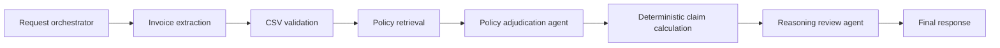

# Source layout and orchestration

```text
src/
  main.py                         # FastAPI entry point; delegates to UI.main
  components/
    agentic_workflow/
      graph.py                    # Compiles the LangGraph workflows
      workflow.py                 # Validates inputs and invokes the graphs
      state.py                    # Request state shared by the nodes
      routers.py                  # Conditional edges, retries and failure routing
      contracts.py                # Agent selections and final workflow report
      policy_adjudicator.py       # Agent 1: selects policy applicability
      reasoning_reviewer.py       # Agent 2: reviews evidence and claim decisions
      nodes/                      # Graph node implementations
    inference/                    # Local extraction, HTTP clients and serving checks
    prompts/                      # Extraction instruction and agent prompts
    rag/                          # Policy indexing, retrieval and rule resolution
      policy_index/               # Existing local Milvus index
      policy_rag_cases.json        # Retrieval evaluation cases
    deploy/vllm/                  # Vision and reasoning server launchers
  config/                         # Settings, model selection and reasoning routes
  utils/
    paths.py                      # Repository-relative path resolution
    policy.py                     # Authoritative policy loading
    rules.py                      # CSV parsing and deterministic rule applicability
    calculator.py                 # Decimal claim arithmetic and reconciliation
  schema/                         # Shared invoice, policy and claim models
```

For the interview, start with `components/agentic_workflow/graph.py` and its
`create_claim_graph` function. `workflow.py` creates fresh request state and invokes
that graph. The active node implementations are in `nodes/copilot.py`; the two
agent implementations live alongside the graph rather than in a separate package.

The normal image path is:



CSV input enters at validation. Conditional edges also handle missing evidence,
bounded retries, failed requests and manual review. Agents select and review
policy evidence; `utils/calculator.py` computes financial amounts. The existing
single-pass `create_graph` remains in the same package for the CLI and API paths
that call `run_claim_workflow`.

Run the application from the repository root:

```bash
python -m uvicorn src.main:app --host 127.0.0.1 --port 8080
bash src/components/deploy/vllm/start_vlm.sh adapter
bash src/components/deploy/vllm/start_reasoning.sh
```

Training uses the root `trainer/` packages. Original training manifests retain
their historical source identifiers. The DPO source hash map resolves those
identifiers to the relocated files, with exact pinned revisions and mandatory
prompt, selection and decision replay. Model weights, labels and prompts retain
their original content.
