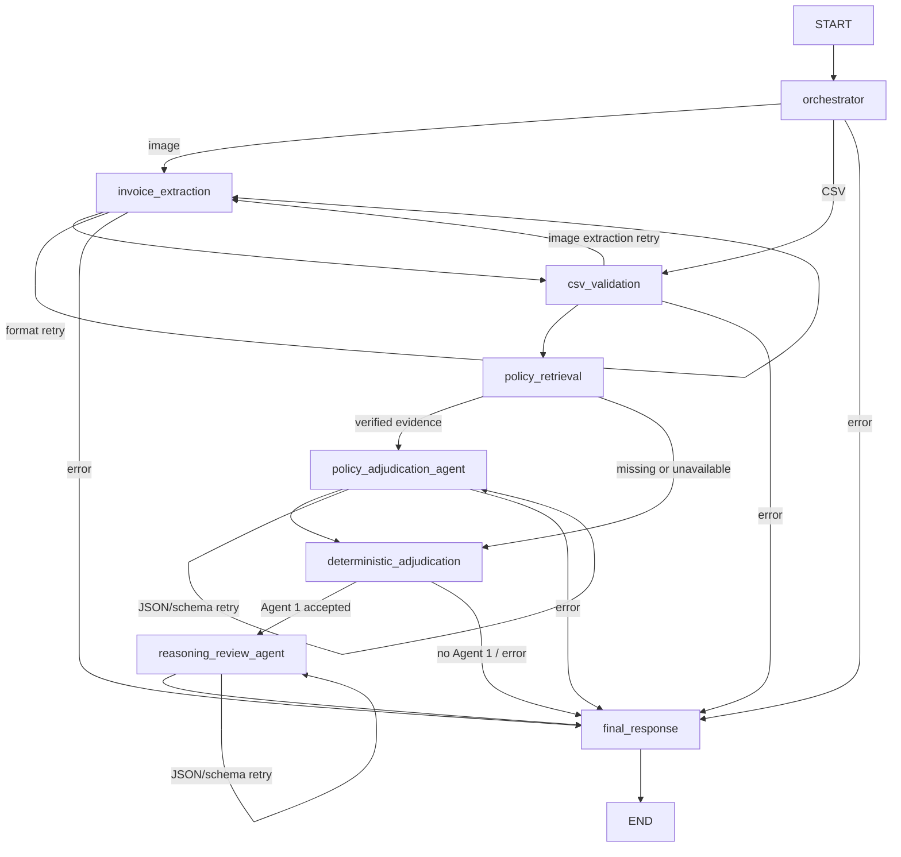

# Phase 7: prepared two-agent claim graph

Code and mocked CPU tests are prepared only. No tests, imports, model calls,
index builds, installations, GPU jobs or services were executed by Codex.

`create_claim_graph` / `run_claim_graph` are the new two-agent entry points.
The existing `create_graph` / `run_claim_workflow` APIs retain their behavior;
FastAPI/UI callers and existing workflow tests are preserved.



The deterministic supervisor selects input/error/retry branches. Shared typed
state contains request/thread IDs, invoice input and validated rows, evidence,
suggestions, the calculator's ClaimResult, reviewed output, errors/warnings,
retry counters and timings. Nodes return updates and fresh lists. Optional
`checkpoint=True` uses installed LangGraph's InMemorySaver in a request-specific
thread namespace; no database, image base64, secrets or raw model JSON are stored.

Invoice extraction uses the existing Phase 6 VLMClient and invoice-extractor.
Each successful agent makes its own qwen-base chat completion request. The text
client reuses Phase 6 transport, checks model identity, counts the actual chat
tokens through vLLM 0.11.2's /tokenize route, requests json_schema output, rejects
truncation/duplicate JSON keys/nonfinite constants, and validates Pydantic output.
Structured decoding availability and live results still require manual checking.

Milvus performs separate coverage/exclusion searches per row. Existing collection
loading, policy hash/model/schema checks remain; database existence, collection
dimension and embedding dimension checks fail safely. Hits are checked against
canonical source documents, deduplicated, and limited to three rules per row for
agent context. Exact canonical category/alias resolution may supplement successful
nonempty retrieval; empty/unavailable/invalid evidence cannot approve an item.
Configuration supports rag.top_k, rag.min_score (default null), and
rag.query_timeout (default 10 seconds). No automatic indexing/rebuilding occurs.

Agent 1 can only suggest a classification supported by the verified canonical
rule, or request review. Its reasons are canonical policy conditions or bounded
review messages. Agent 2 echoes exact verified statuses, amounts and totals and
selects an explanation from the supplied deterministic explanation/cited policy
conditions. Unrestricted prose is intentionally rejected: citation membership
alone cannot prove the truth of generated prose. The final builder always uses
the unchanged Decimal adjudicator's numbers/statuses, never the echoed numbers.

An instruction-pattern screen rejects obvious injection strings; it is not a
complete semantic injection detector. The stronger boundaries are structured
untrusted-data messages, exact canonical rule matching, citation allowlists,
restricted explanations, and no agent access to tools, files or financial logic.

Retry budget is global per request: default one optional formatting retry total,
configurable to zero. Transport, model identity, citation and financial failures
are not retried. Missing evidence yields REVIEW_REQUIRED with pending amounts.
Invalid Agent 1 prevents adjudication. Invalid Agent 2 preserves the verified
ClaimResult, discards its response, and returns REVIEW_REQUIRED with deterministic
explanations explicitly marked unreviewed. CLI exit codes: 0 completed, 2 review,
1 failed. Timeouts are checked between operations and bounded HTTP/Milvus calls;
they do not forcibly interrupt an in-progress Python CPU embedding operation.

## Manual commands (from the Git repository)

```bash
cd /home/rishabh_mishra0440/optum_claim_adjudication/optum_claim_adjudication
source ../.venv/bin/activate
CUDA_VISIBLE_DEVICES='' python -m unittest tests.test_claim_graph
CUDA_VISIBLE_DEVICES='' python -m unittest tests.test_phase6 tests.test_phase7 tests.test_phase8
```

Required packages already have distribution metadata in the application .venv:
LangGraph 1.2.14, Pydantic 2.14.0, httpx 0.28.1, pymilvus 3.0.2,
milvus-lite 3.2.1 and sentence-transformers 5.7.0. Imports/runtime ABI compatibility
are unverified. Existing requirements-workflow.txt and requirements-rag.txt
describe the dependencies; no additional package was introduced or installed.
Do not install the serving stack into the application/training environment.

23 new test methods cover compiled routing, state isolation, real client request
construction, both agent calls, failures/retries, evidence/citations, protected
amounts, checkpointing and all five existing reference invoices. They are unrun.
An existing Phase 6 test in tests/test_vllm_inference.py mocks sys.prefix without
sys.executable. Source inspection indicates that preflight mock needs adjustment after the earlier environment
path fix; this is separate from Phase 7 and was left unchanged. To inspect that
suite manually: `CUDA_VISIBLE_DEVICES='' python -m unittest tests.test_vllm_inference`.

If the policy index is absent, manually run `python -m scripts.build_policy_index`.
For an explicitly diagnosed stale/incompatible index, manually run
`python -m scripts.build_policy_index --rebuild`. Confirm the embedding model is
already cached before indexing if downloads are not desired. Neither command
was run during preparation.

With the existing adapter-mode server already running:

```bash
python -u -m scripts.run_claim_graph --image data/synthetic/validation/images/invoice_00004.jpg --date 2025-10-27 --endpoint http://127.0.0.1:8000 --output-dir reports/claim_graph/image --verbose
python -u -m scripts.run_claim_graph --csv data/evaluation/ground_truth/invoice_01_standard.csv --date 2024-01-15 --endpoint http://127.0.0.1:8000 --output-dir reports/claim_graph/reference_csv --verbose
```

The synthetic validation image is dated 27 Oct 2025. policy.json is effective
only during 2024: the image demonstration must therefore require review and
cannot finalize reimbursement. Do not falsify its date to force an approval.
The reference CSV command tests existing CSV input; it is explicitly supplied
input and is never substituted into image extraction.

The 2048-token server limit is checked before each agent completion. Larger
invoices may exceed it and fail safely; token/context settings and structured
decoding backend behavior require manual verification. No hidden batching,
second model/server, automatic context extension or text-only extraction fallback.

Each reports/claim_graph/<run>/ contains final_report.json, policy_evidence.json,
agent_1.json, deterministic_claim.json, agent_2.json, trace.json, and
validated_invoice.csv when validation succeeds. Skipped/rejected agent files
contain JSON null. Existing Phase 6 extraction also retains its real raw response
and diagnostics under reports/inference/adapter/<run>/.
